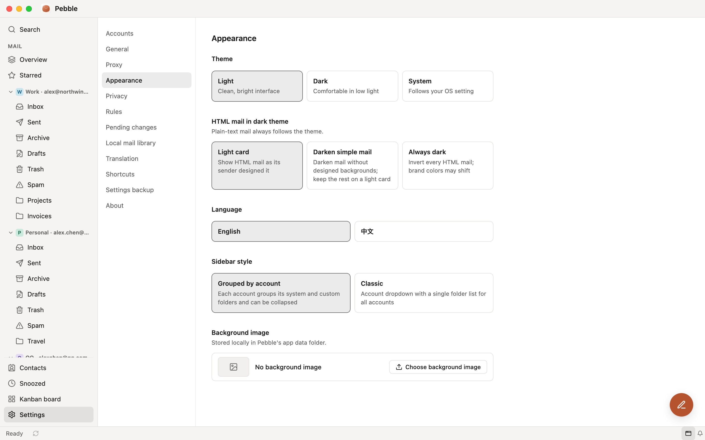

<p align="center">
  
</p>

<h1 align="center">Pebble</h1>

<p align="center">
  A local-first desktop email client for people who want a calmer, more private inbox.
</p>

<p align="center">
  <a href="README.zh-CN.md">简体中文</a>
  ·
  <a href="https://github.com/QingJ01/Pebble/releases">Releases</a>
  ·
  <a href="LICENSE">License</a>
</p>

<p align="center">
  <a href="https://github.com/QingJ01/Pebble/releases"></a>
  <a href="LICENSE"></a>
  <a href="https://github.com/QingJ01/Pebble/actions"></a>
  
</p>

## Overview

Pebble is a desktop mail client built with Rust, Tauri, and React. It keeps mail data, the search index, attachments, rules, and application settings on your device by default.

The app is designed around a few practical ideas:

- Your mailbox should stay readable, fast, and quiet.
- Email workflows should be local-first instead of cloud-dashboard-first.
- Privacy controls should be explicit, visible, and easy to override per message.
- Search, snooze, rules, and a Kanban board should work together instead of living in separate tools.

Pebble currently supports Gmail, IMAP, POP3, and experimental Outlook accounts.

## Highlights

### Local-first privacy

- Local SQLite database for messages, folders, labels, rules, and settings.
- Local Tantivy full-text index for fast search.
- Attachments are stored on disk under the app data directory.
- OAuth tokens and credentials are encrypted with a per-device key.
- No telemetry.
- Network requests are limited to features you configure: mail sync, translation, and optional WebDAV settings backup.

### Mail workflow

- Unified inbox across multiple accounts.
- Gmail, IMAP, POP3, and experimental Outlook support.
- Threaded and message-list views.
- Archive, delete, star, mark read, batch actions, and restore flows.
- Snooze messages and bring them back later.
- Full-text search and advanced filters.
- Rules engine for automatic organization.
- Email CSS rendering with embedded style support.
- Option to allow invalid TLS certificates for self-hosted mail servers.

### Productivity tools

- Local address book with search, favorites, notes, multiple labeled email addresses, and one-click contact actions from message participants.
- Recipient autocomplete that prioritizes saved contacts and falls back to recent correspondents.
- vCard (`.vcf`) import and export for moving contacts between Pebble and other address books. Re-imports merge by normalized email; existing non-empty local names and notes take precedence over imported values.
- Kanban board with Todo, Waiting, and Done columns.
- Command palette and keyboard-first navigation.
- Built-in translation providers with bilingual reading and customizable shortcuts (`T` to translate selection, `Ctrl+Shift+T` to toggle bilingual view).
- Dark and light themes with wallpaper background support.
- English and Chinese UI.
- Optional local file export/import and WebDAV backup for contacts, settings, rules, Kanban cards, Kanban notes, and separately encrypted account secrets.
- Automatic scheduled WebDAV backup with configurable interval.

### Platform integration

- Native macOS traffic-light window controls.
- Register as default email client on Windows (Settings > General).
- Tray mode keeps mail sync running while the window is hidden.
- Start hidden to system tray option.
- `mailto:` protocol handler for composing mail from external apps.

## Screenshots

<table>
  <tr>
    <td><br><b>Inbox</b></td>
    <td><br><b>Kanban</b></td>
  </tr>
  <tr>
    <td><br><b>Dark Mode</b></td>
    <td><br><b>Settings</b></td>
  </tr>
</table>

## Tech Stack

| Layer | Technology |
| --- | --- |
| Desktop shell | Tauri 2 |
| Backend | Rust |
| Frontend | React 19, TypeScript |
| State | Zustand, TanStack Query |
| Database | SQLite via rusqlite |
| Search | Tantivy |
| Styling | Tailwind CSS and app CSS |
| Localization | i18next |

## Getting Started

### Install

Download prebuilt desktop packages from the [Releases](https://github.com/QingJ01/Pebble/releases) page.

On Arch Linux, Pebble is available from the AUR as `pebble-bin`:

```bash
yay -S pebble-bin
# or
paru -S pebble-bin
```

On Fedora and other rpm-based distributions, older releases were packaged as `pebble`, a name Fedora also uses for Let's Encrypt's ACME test server, so `dnf upgrade` could replace Pebble with it ([#114](https://github.com/QingJ01/Pebble/issues/114)). The package is now `pebble-mail`. To switch, install the new rpm, then remove the old package; your mail and settings are kept:

```bash
sudo dnf install ./pebble-mail-<version>-1.x86_64.rpm
sudo dnf remove pebble
```

### Prerequisites

- Rust stable
- Node.js 18 or newer
- pnpm 8 or newer
- Tauri system dependencies for your platform

### Profile Storage

By default, Pebble stores the database, search index, attachments, logs, imported backgrounds, and local interface preferences under the system app data directory.

You can opt into a custom or portable profile directory before Pebble starts:

- Set `PEBBLE_PROFILE_DIR` to an absolute path.
- Put `pebble-profile.txt` next to `pebble.exe`; the first line can be an absolute path or a path relative to the executable directory.
- Create a `pebble-profile` directory next to `pebble.exe` to store Pebble data beside the app.

The selected directory is used on the next app launch.

### Development Setup

```bash
git clone https://github.com/QingJ01/Pebble.git
cd Pebble

pnpm install
cp .env.example .env

pnpm dev
```

The development command starts the Vite frontend and the Tauri desktop app.

### Build

```bash
pnpm build
pnpm build:windows
pnpm build:macos
pnpm build:linux
```

Desktop bundles are written under `target/release/` and `target/release/bundle/`.
On Linux, install the Tauri system dependencies first; `pnpm build:linux` produces AppImage, deb, and rpm packages under `target/release/bundle/`.
macOS bundles are unsigned unless you provide your own signing setup.
After copying an unsigned macOS build to `/Applications`, run the following command before opening it:

```bash
sudo xattr -cr /Applications/Pebble.app
```

## OAuth Configuration

Pebble can connect to Gmail and Outlook through OAuth. IMAP accounts use the IMAP/SMTP credentials configured in the app.

Copy `.env.example` to `.env`, then fill the provider values you need.

| Variable | Description |
| --- | --- |
| `GOOGLE_CLIENT_ID` | Google OAuth client ID. Use a Desktop app client when possible. |
| `GOOGLE_CLIENT_SECRET` | Optional for PKCE flows. Add it if Google rejects token exchange with `client_secret is missing`. |
| `MICROSOFT_CLIENT_ID` | Microsoft public/native app client ID. |
| `MICROSOFT_CLIENT_SECRET` | Optional. Leave empty for public/native Microsoft apps. |

## Useful Scripts

| Command | Purpose |
| --- | --- |
| `pnpm dev` | Run the Tauri desktop app in development mode. |
| `pnpm dev:frontend` | Run only the Vite frontend dev server. |
| `pnpm test` | Run frontend tests with Vitest. |
| `pnpm build:frontend` | Type-check and build the frontend. |
| `pnpm build` | Build the desktop app for the current platform. |
| `pnpm build:windows` | Build the Windows NSIS installer. |
| `pnpm build:macos` | Build unsigned macOS `.app` and `.dmg` bundles. |
| `pnpm build:linux` | Build Linux `.AppImage`, `.deb`, and `.rpm` packages. |
| `cargo test -p pebble-mail` | Run the mail crate tests. |
| `cargo check` | Check the Rust workspace. |

## Project Structure

```text
Pebble/
|-- src/                    React frontend
|   |-- components/         Shared UI components
|   |-- features/           Inbox, compose, search, Kanban, settings
|   |-- hooks/              React hooks and query helpers
|   |-- lib/                IPC API, i18n, utilities
|   `-- stores/             Zustand stores
|-- src-tauri/              Tauri application and IPC commands
|-- crates/                 Rust workspace crates
|   |-- pebble-core/        Shared types and errors
|   |-- pebble-store/       SQLite persistence
|   |-- pebble-mail/        Mail providers and sync
|   |-- pebble-search/      Tantivy search index
|   |-- pebble-crypto/      Credential encryption
|   |-- pebble-oauth/       OAuth 2.0 and PKCE
|   |-- pebble-rules/       Rules engine
|   |-- pebble-translate/   Translation providers
|   `-- pebble-privacy/     HTML sanitizing and tracker controls
|-- tests/                  Frontend tests
`-- site/                   Static project site and screenshots
```

## Keyboard Shortcuts

| Shortcut | Action |
| --- | --- |
| `J` / `K` | Move through messages |
| `Enter` | Open the selected message |
| `E` | Archive |
| `S` | Toggle star |
| `R` | Reply |
| `A` | Reply all |
| `F` | Forward |
| `C` | Compose |
| `/` | Focus search |
| `T` | Translate selected text |
| `Ctrl+Shift+T` | Toggle bilingual view |
| `Esc` | Close, cancel, or go back |

Shortcuts can be reviewed and customized in Settings.

## Pebble Web

Looking for a self-hosted web version? **[Pebble Web](https://github.com/QingJ01/Pebble-Web)** provides the same features as the desktop app, accessible from any browser via Docker.

```bash
curl -fsSL https://raw.githubusercontent.com/QingJ01/Pebble-Web/main/docker-compose.yml -o docker-compose.yml && docker compose up -d
```

Pebble Web shares the same Rust core crates and React frontend. Deploy it on your own server and access your email anywhere.

## Status

Pebble is under active development. It is usable for day-to-day testing, but mail clients handle sensitive data and provider behavior varies. Keep backups of important mail, and verify account actions against your provider when testing new builds.

## Contributing

Issues and pull requests are welcome.

For code changes, please keep patches focused and include tests for behavior changes when practical. Before submitting, run the relevant checks:

```bash
pnpm test
pnpm build:frontend
cargo check
```

## License

Pebble is licensed under the [GNU Affero General Public License v3.0](LICENSE).

---

<p align="center">
  Built by <a href="https://github.com/QingJ01">QingJ</a>.
  <br>
  Friend link: <a href="https://linux.do">LINUX DO</a>
</p>
