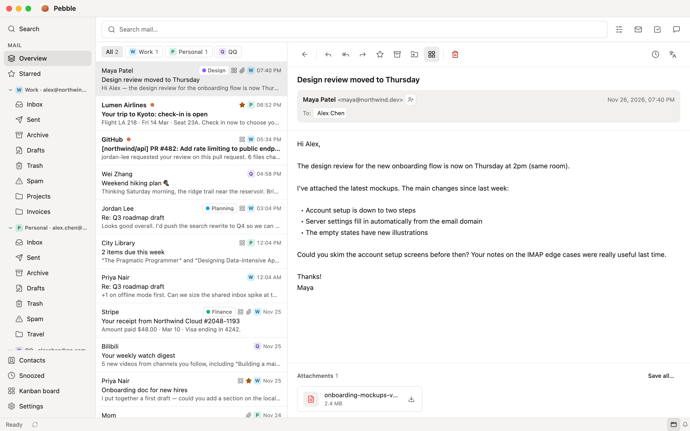
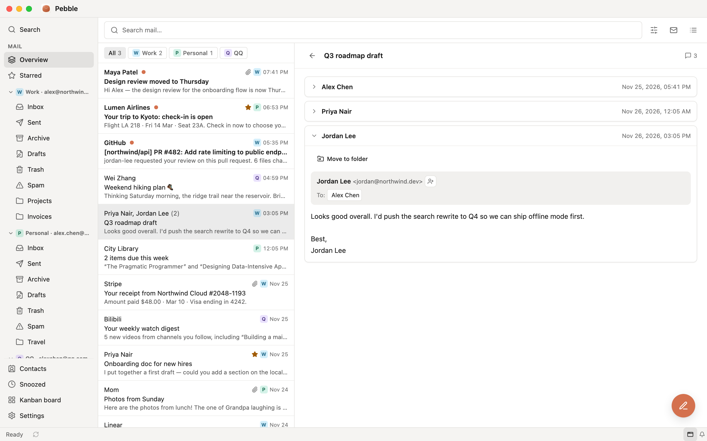
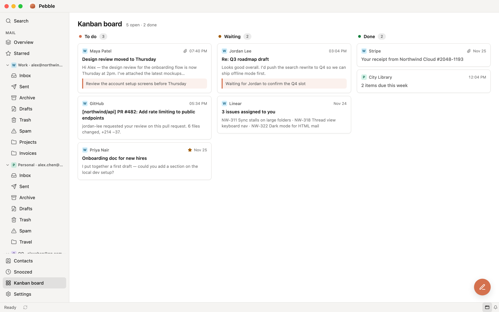
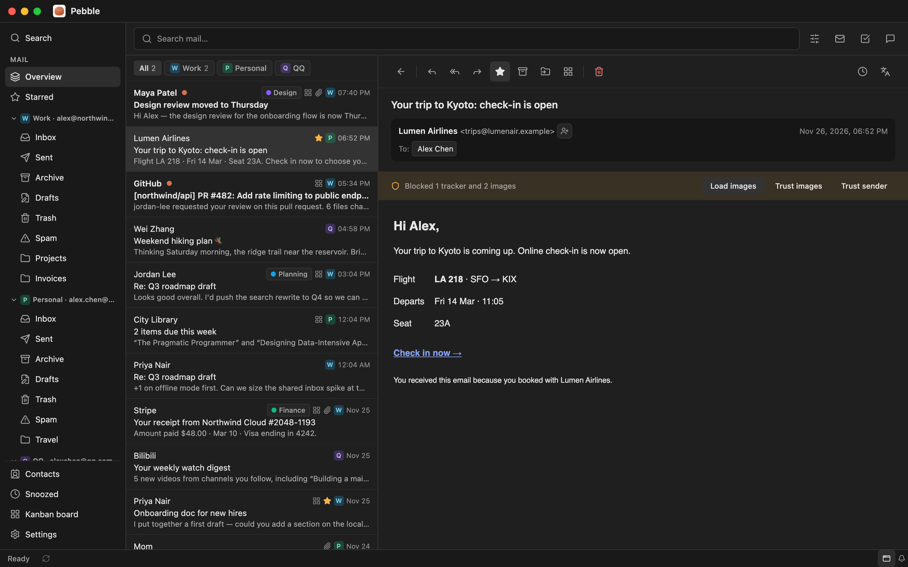

<p align="center">
  
</p>

<h1 align="center">Pebble</h1>

<p align="center">
  A local-first desktop email client for people who want a calmer, more private inbox.
</p>

<p align="center">
  <a href="README.zh-CN.md">简体中文</a>
  ·
  <a href="https://github.com/QingJ01/Pebble/releases">Releases</a>
  ·
  <a href="CHANGELOG.md">Changelog</a>
  ·
  <a href="LICENSE">License</a>
</p>

<p align="center">
  <a href="https://github.com/QingJ01/Pebble/releases"></a>
  <a href="LICENSE"></a>
  <a href="https://github.com/QingJ01/Pebble/actions"></a>
  
</p>

<p align="center">
  
</p>

## Overview

Pebble is a desktop mail client built with Rust, Tauri and React. Your mail, search index, attachments, rules and settings stay on your device; nothing is sent anywhere except to the mail servers and services you set up.

- **One inbox for every account.** Gmail, Outlook, IMAP and POP3 side by side, with each account's colour and initial on every row.
- **Quiet by default.** Remote images and trackers are blocked until you allow them, per message or per sender.
- **Mail as a to-do list.** Snooze, rules, a Kanban board and undoable actions work together.
- **Fast on big mailboxes.** Cursor-paged lists, streamed first syncs and a local full-text index.

> Sample data in the screenshots is made up.

## Features

### Reading and organizing

- Unified inbox across accounts, with filter chips to narrow it to one account and unread counts per account.
- Message and conversation views; conversations keep each account's copies apart.
- **Show unread only** filter for the message and conversation lists.
- Archive, delete, mark as spam, star and mark read, one at a time or in batches, each with **Undo**.
- Create and rename folders, move messages with **Move to folder** or by **dragging them onto a folder** in the sidebar. Gmail labels are kept.
- Snooze messages until later, and a Kanban board (To do, Waiting, Done) for mail you need to act on.
- Rules that label, move, mark read, archive or file messages to the board as they arrive.
- Full-text search with filters for sender, recipient, subject, date range, attachments and folder.
- Right-click menu on message rows; keyboard shortcuts for everything common.

### Writing

- Compose in rich text, Markdown or HTML source; drafts keep recipients, Bcc and attachments, and reply quotes sit inside the editor.
- **Undo Send** and **scheduled sending**. Queued mail is encrypted on disk and survives restarts.
- Recipient autocomplete from your address book and recent correspondents.
- `mailto:` links from other apps open a new message; on Windows, Pebble can register as the default mail app (Settings → General).

### Privacy and local-first

- SQLite database, Tantivy search index and attachments stored in your profile folder.
- Remote images and tracking pixels blocked by default, with one-click **Load images**, **Trust images** or **Trust sender**.
- HTML mail is sanitized and its CSS confined to the message area.
- Passwords and OAuth tokens encrypted with a per-device key and never handed to the interface.
- No telemetry. Network access is limited to mail sync and the optional translation, proxy and WebDAV backup features you configure.

### Comfort

- Light, dark and system themes, an optional wallpaper, and a choice for **HTML mail in the dark theme**: keep the sender's light design, darken simple mail, or darken everything.
- Grouped-by-account or classic sidebar; narrow windows switch to a compact rail.
- Built-in translation with a bilingual reading view.
- Image and PDF attachment preview, and Save all.
- English and Simplified Chinese interface.
- Tray mode keeps mail syncing while the window is closed; optional start hidden in the tray.

### Accounts, backup and data

- Gmail and Outlook sign-in with OAuth; IMAP/SMTP and POP3 for everything else.
- **Server settings fill in automatically** for about 30 common providers (Outlook, iCloud, Yahoo, QQ, NetEase 163/126, 139, Sina, Aliyun and more) as soon as you type the address.
- Per-account sync range, HTTP proxy, and an option for self-signed certificates on self-hosted servers.
- Local address book with favourites, notes and vCard (`.vcf`) import/export.
- Local mail archive with EML and mbox import/export.
- Encrypted backup of settings, rules, contacts and Kanban cards to a file or to WebDAV, optionally on a schedule.

## Screenshots

<table>
  <tr>
    <td><br><b>Conversations</b></td>
    <td><br><b>Kanban board</b></td>
  </tr>
  <tr>
    <td><br><b>Dark theme</b></td>
    <td><br><b>Settings</b></td>
  </tr>
</table>

## Install

Download the latest build from [Releases](https://github.com/QingJ01/Pebble/releases):

| Platform | File |
| --- | --- |
| Windows | `Pebble_<version>_x64-setup.exe` |
| macOS (Apple silicon) | `Pebble_<version>_aarch64-arm64.dmg` |
| macOS (Intel) | `Pebble_<version>_x64-x64.dmg` |
| Linux | `.AppImage`, `.deb` or `.rpm` |

Each file has a matching `.sha256` checksum.

macOS builds are not signed. After copying Pebble to `/Applications`, run this once before opening it:

```bash
sudo xattr -cr /Applications/Pebble.app
```

On Arch Linux, Pebble is in the AUR as `pebble-bin`:

```bash
yay -S pebble-bin
```

### Adding an account

- **Gmail / Outlook:** use the sign-in buttons. If Google blocks the sign-in for your account, add the account manually with an [app password](https://myaccount.google.com/apppasswords) instead (see [#86](https://github.com/QingJ01/Pebble/issues/86)).
- **Other providers:** type your address and Pebble fills in the server settings for common providers. Most Chinese providers (QQ, 163, 126, 139, Sina…) and iCloud need an authorization code or app password from the provider's web settings, not your sign-in password.

### Where your data lives

Pebble keeps its database, search index, attachments, logs and preferences in the system app-data folder. To keep them somewhere else, before starting Pebble:

- set `PEBBLE_PROFILE_DIR` to an absolute path, or
- put `pebble-profile.txt` next to the executable, with an absolute path or a path relative to the executable on its first line, or
- create a `pebble-profile` folder next to the executable to keep the data beside the app.

The new location is used from the next launch.

## Development

### Prerequisites

- Rust (stable)
- Node.js 22 (18 or newer works)
- pnpm 9
- The [Tauri system dependencies](https://tauri.app/start/prerequisites/) for your platform

### Run from source

```bash
git clone https://github.com/QingJ01/Pebble.git
cd Pebble
pnpm install
cp .env.example .env   # optional: OAuth client IDs for Gmail / Outlook
pnpm dev
```

`pnpm dev` starts the Vite frontend and the Tauri app together.

### OAuth configuration

Gmail and Outlook sign-in need your own OAuth client IDs in `.env`. IMAP and POP3 accounts work without them.

| Variable | Description |
| --- | --- |
| `GOOGLE_CLIENT_ID` | Google OAuth client ID (a "Desktop app" client). |
| `GOOGLE_CLIENT_SECRET` | Optional. Set it if Google rejects the token exchange with `client_secret is missing`. |
| `MICROSOFT_CLIENT_ID` | Microsoft public/native client ID, redirect URI `http://localhost`. |
| `MICROSOFT_CLIENT_SECRET` | Optional; leave empty for public clients (PKCE). |

In development the values are read from `.env`; release builds take them from the build environment and ignore `.env`.

### Scripts

| Command | Purpose |
| --- | --- |
| `pnpm dev` | Run the desktop app in development mode. |
| `pnpm dev:frontend` | Run only the Vite frontend. |
| `pnpm test` | Frontend tests (Vitest). |
| `pnpm check:i18n` | Check that English and Chinese strings match. |
| `pnpm build:frontend` | Type-check and build the frontend. |
| `pnpm build` | Build the desktop app for the current platform. |
| `pnpm build:windows` / `build:macos` / `build:linux` | Build installers for one platform (NSIS; `.app` + `.dmg`; AppImage, deb and rpm). |
| `cargo test --workspace` | Rust tests. |

Bundles are written to `target/release/bundle/`.

### Project structure

```text
Pebble/
|-- src/                    React frontend
|   |-- app/                App shell, title bar, startup hooks
|   |-- components/         Shared UI (lists, reader, sidebar, dialogs)
|   |-- features/           Inbox, compose, search, Kanban, contacts,
|   |                       snoozed, starred, mail archive, settings
|   |-- hooks/              React hooks, queries and mutations
|   |-- lib/                IPC API, i18n, helpers
|   |-- locales/            English and Chinese strings
|   `-- stores/             Zustand stores
|-- src-tauri/              Tauri app and IPC commands
|-- crates/
|   |-- pebble-core/        Shared types and errors
|   |-- pebble-store/       SQLite storage and migrations
|   |-- pebble-mail/        IMAP, SMTP, POP3, Gmail and Outlook sync
|   |-- pebble-search/      Tantivy search index
|   |-- pebble-privacy/     HTML sanitizing and tracker blocking
|   |-- pebble-crypto/      Credential encryption
|   |-- pebble-oauth/       OAuth 2.0 with PKCE
|   |-- pebble-rules/       Rules engine
|   |-- pebble-translate/   Translation providers
|   `-- pebble-webdav/      WebDAV backup
|-- tests/                  Frontend tests
`-- site/                   Project website and screenshots
```

### Tech stack

| Layer | Technology |
| --- | --- |
| Desktop shell | Tauri 2 |
| Backend | Rust |
| Frontend | React 19, TypeScript |
| State | Zustand, TanStack Query |
| Database | SQLite (rusqlite) |
| Search | Tantivy |
| Styling | Tailwind CSS 4 and app CSS |
| Localization | i18next |

## Keyboard shortcuts

| Shortcut | Action |
| --- | --- |
| `J` / `K` | Next / previous message |
| `Enter` | Open message |
| `E` | Archive |
| `S` | Star |
| `R` / `A` / `F` | Reply / Reply all / Forward |
| `C` | New message |
| `/` | Focus search |
| `Ctrl+K` | Command palette |
| `Ctrl+Shift+I` / `Ctrl+Shift+K` | Inbox / Kanban board |
| `Ctrl+Shift+F` | Search |
| `T` | Translate selected text |
| `Ctrl+Shift+T` | Bilingual view |
| `Esc` | Close or go back |

All shortcuts can be changed in Settings → Shortcuts.

## Pebble Web

Prefer the browser? **[Pebble Web](https://github.com/QingJ01/Pebble-Web)** is a self-hosted version that runs in Docker and shares Pebble's Rust core and React frontend.

```bash
curl -fsSL https://raw.githubusercontent.com/QingJ01/Pebble-Web/main/docker-compose.yml -o docker-compose.yml && docker compose up -d
```

## Status

Pebble is under active development and fine for daily use, but mail clients handle sensitive data and providers behave differently. Keep backups of important mail, and check the [changelog](CHANGELOG.md) before upgrading: some releases migrate the database on first launch (Pebble backs it up first).

## Contributing

Issues and pull requests are welcome. Keep patches focused and add tests for behaviour changes where practical. Before opening a pull request, run:

```bash
pnpm test
pnpm check:i18n
pnpm build:frontend
cargo test --workspace
```

## License

Pebble is licensed under the [GNU Affero General Public License v3.0](LICENSE).

---

<p align="center">
  Built by <a href="https://github.com/QingJ01">QingJ</a>.
  <br>
  Friend link: <a href="https://linux.do">LINUX DO</a>
</p>
