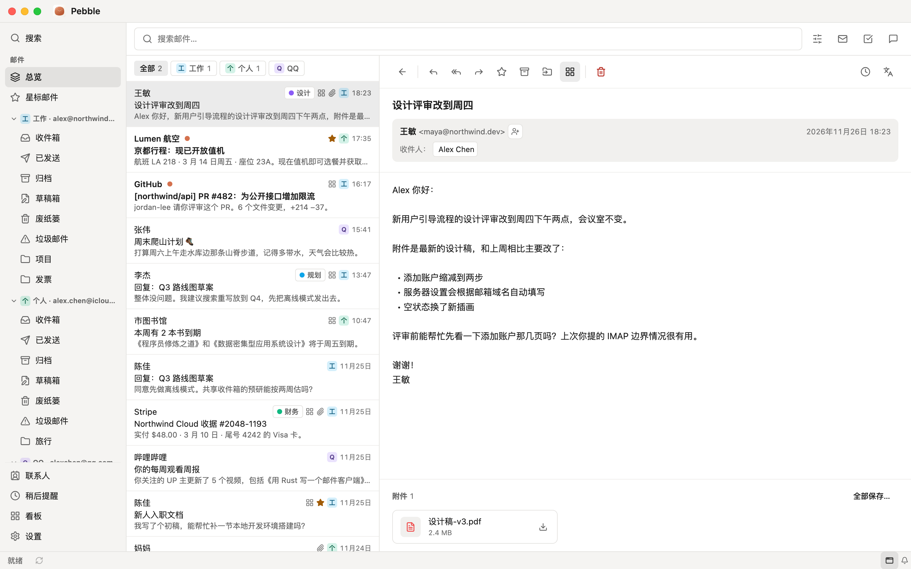
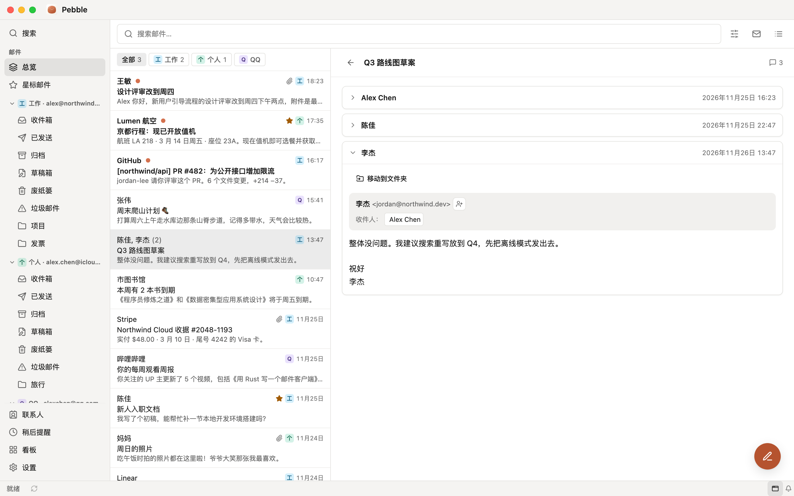
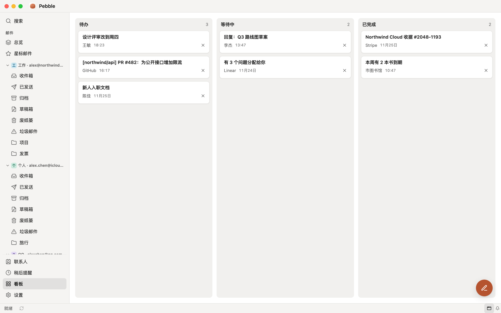
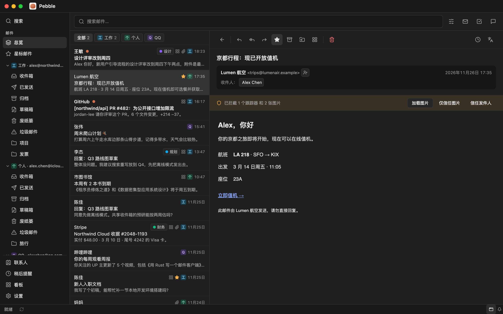
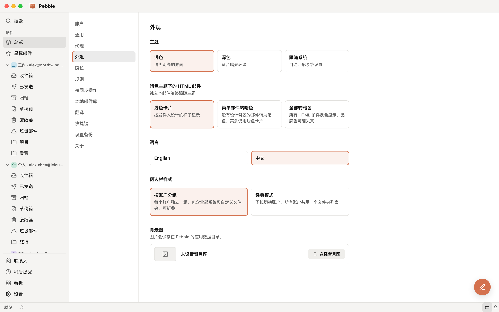

<p align="center">
  
</p>

<h1 align="center">Pebble</h1>

<p align="center">
  本地优先的桌面邮件客户端，让收件箱更安静、更私密。
</p>

<p align="center">
  <a href="README.md">English</a>
  ·
  <a href="https://github.com/QingJ01/Pebble/releases">下载</a>
  ·
  <a href="CHANGELOG.md">更新日志</a>
  ·
  <a href="LICENSE">许可证</a>
</p>

<p align="center">
  <a href="https://github.com/QingJ01/Pebble/releases"></a>
  <a href="LICENSE"></a>
  <a href="https://github.com/QingJ01/Pebble/actions"></a>
  
</p>

<p align="center">
  
</p>

## 简介

Pebble 是用 Rust、Tauri 和 React 构建的桌面邮件客户端。邮件、搜索索引、附件、规则和设置都保存在你自己的设备上，除了你配置的邮件服务器和服务，不会向任何地方发送数据。

- **所有账户一个收件箱。** Gmail、Outlook、IMAP 和 POP3 放在一起，每一行都带账户颜色和首字母标识。
- **默认安静。** 远程图片和追踪像素先拦截，按邮件或按发件人放行。
- **把邮件当待办。** 稍后提醒、规则、看板和可撤销的操作互相配合。
- **大邮箱也快。** 游标分页的列表、可续传的首次同步、本地全文索引。

> 截图中的示例数据均为虚构。

## 功能

### 阅读与整理

- 多账户聚合收件箱，可用顶部标签筛选到单个账户，并显示各账户未读数。
- 邮件视图和会话视图；会话按账户区分，不会混在一起。
- **只看未读**筛选，邮件视图和会话视图都能用。
- 归档、删除、标记垃圾邮件、星标、标记已读，可单封也可批量，都能**撤销**。
- 新建、重命名文件夹；用「移动到文件夹」或**直接拖到侧栏文件夹**移动邮件，Gmail 标签会保留。
- 稍后提醒；看板（待办、等待中、已完成）管理需要处理的邮件。
- 规则：新邮件到达时自动打标签、移动、标为已读、归档或放进看板。
- 全文搜索，可按发件人、收件人、主题、时间范围、附件和文件夹筛选。
- 邮件行右键菜单；常用操作都有快捷键。

### 写邮件

- 支持富文本、Markdown 和 HTML 源码三种编辑模式；草稿会保留收件人、密送和附件，回复引用直接在编辑器里。
- **撤销发送**和**定时发送**。待发送的邮件加密保存在本地，重启后依然有效。
- 收件人自动补全，优先通讯录，其次最近联系人。
- 其他应用的 `mailto:` 链接会直接打开新邮件；在 Windows 上可以把 Pebble 注册为默认邮件应用（设置 → 通用）。

### 隐私与本地优先

- SQLite 数据库、Tantivy 搜索索引和附件都保存在你的配置目录中。
- 默认拦截远程图片和追踪像素，一键**加载图片**、**信任图片**或**信任发件人**。
- HTML 邮件经过清理，邮件里的 CSS 只作用于邮件区域。
- 密码和 OAuth 令牌用设备专属密钥加密，不会传给界面层。
- 没有遥测。联网只限于邮件同步，以及你自己开启的翻译、代理和 WebDAV 备份。

### 使用体验

- 浅色、深色、跟随系统三种主题，可设置壁纸；**暗色主题下的 HTML 邮件**可选：保持发件人的浅色设计、简单邮件转暗色，或全部转暗色。
- 侧栏可按账户分组或使用经典样式；窗口变窄时自动切换为紧凑图标栏。
- 内置翻译，支持双语对照阅读。
- 图片和 PDF 附件预览，一键全部保存。
- 中文和英文界面。
- 托盘模式：关闭窗口后仍在后台同步；可设置启动时隐藏到托盘。

### 账户、备份与数据

- Gmail 和 Outlook 使用 OAuth 登录；其他邮箱使用 IMAP/SMTP 或 POP3。
- 输入邮箱地址后，**自动填好服务器设置**，覆盖约 30 家常用邮箱（Outlook、iCloud、Yahoo、QQ、网易 163/126、139、新浪、阿里邮箱等）。
- 每个账户可单独设置同步范围、HTTP 代理，自建服务器可允许自签名证书。
- 本地通讯录，支持收藏、备注和 vCard（`.vcf`）导入导出。
- 本地邮件库，支持 EML 和 mbox 导入导出。
- 设置、规则、联系人和看板卡片可加密备份到文件或 WebDAV，也可定时自动备份。

## 截图

<table>
  <tr>
    <td><br><b>会话视图</b></td>
    <td><br><b>看板</b></td>
  </tr>
  <tr>
    <td><br><b>暗色主题</b></td>
    <td><br><b>设置</b></td>
  </tr>
</table>

## 安装

在 [Releases](https://github.com/QingJ01/Pebble/releases) 下载最新版本：

| 平台 | 文件 |
| --- | --- |
| Windows | `Pebble_<版本>_x64-setup.exe` |
| macOS（Apple 芯片） | `Pebble_<版本>_aarch64-arm64.dmg` |
| macOS（Intel） | `Pebble_<版本>_x64-x64.dmg` |
| Linux | `pebble-mail_<version>_amd64.AppImage`、`pebble-mail_<version>_amd64.deb`、`pebble-mail-<version>-1.x86_64.rpm` |

每个文件都附有对应的 `.sha256` 校验文件。

macOS 版本没有签名。把 Pebble 拷到「应用程序」后，首次打开前运行一次：

```bash
sudo xattr -cr /Applications/Pebble.app
```

Arch Linux 用户可以从 AUR 安装 `pebble-bin`：

```bash
yay -S pebble-bin
```

在 Fedora 等基于 rpm 的发行版上，旧版本的软件包名为 `pebble`，而 Fedora 的 Let's Encrypt ACME 测试服务器也使用这个名字，因此 `dnf upgrade` 可能会把 Pebble 替换掉（[#114](https://github.com/QingJ01/Pebble/issues/114)）。现在软件包名为 `pebble-mail`。切换时先安装新的 rpm，再卸载旧软件包，邮件和设置都会保留：

```bash
sudo dnf install ./pebble-mail-<version>-1.x86_64.rpm
sudo dnf remove pebble
```

如果之前把 Pebble 固定在了程序坞或任务栏，切换后请重新固定。如果 Pebble 是默认邮件应用，它会在首次启动时自动更新该设置。

### 添加账户

- **Gmail / Outlook：** 使用登录按钮。如果 Google 拦截了你账户的登录，可以改用[应用专用密码](https://myaccount.google.com/apppasswords)手动添加，参见 [#86](https://github.com/QingJ01/Pebble/issues/86)。
- **其他邮箱：** 输入邮箱地址后，常见邮箱会自动填好服务器设置。QQ、163、126、139、新浪等国内邮箱以及 iCloud 一般需要在网页版设置里开启 IMAP/SMTP 并生成**授权码**，填授权码而不是登录密码。

### 数据保存位置

Pebble 默认把数据库、搜索索引、附件、日志和偏好设置保存在系统的应用数据目录。如需换个位置，请在启动 Pebble 前：

- 设置环境变量 `PEBBLE_PROFILE_DIR` 为一个绝对路径；或
- 在程序旁边放一个 `pebble-profile.txt`，第一行写绝对路径或相对于程序目录的路径；或
- 在程序旁边新建 `pebble-profile` 文件夹，数据就放在程序旁边。

下次启动时生效。

## 开发

### 环境要求

- Rust（stable）
- Node.js 22（18 及以上即可）
- pnpm 9
- 对应平台的 [Tauri 系统依赖](https://tauri.app/start/prerequisites/)

### 从源码运行

```bash
git clone https://github.com/QingJ01/Pebble.git
cd Pebble
pnpm install
cp .env.example .env   # 可选：Gmail / Outlook 的 OAuth 客户端 ID
pnpm dev
```

`pnpm dev` 会同时启动 Vite 前端和 Tauri 应用。

### OAuth 配置

Gmail 和 Outlook 登录需要在 `.env` 里填写你自己的 OAuth 客户端 ID；IMAP 和 POP3 账户不需要。

| 变量 | 说明 |
| --- | --- |
| `GOOGLE_CLIENT_ID` | Google OAuth 客户端 ID（「桌面应用」类型）。 |
| `GOOGLE_CLIENT_SECRET` | 可选。如果 Google 换取令牌时报 `client_secret is missing`，请填写。 |
| `MICROSOFT_CLIENT_ID` | Microsoft 公共/原生客户端 ID，重定向 URI 为 `http://localhost`。 |
| `MICROSOFT_CLIENT_SECRET` | 可选；公共客户端（PKCE）留空即可。 |

开发时从 `.env` 读取；正式构建从构建环境读取，忽略 `.env`。

### 常用命令

| 命令 | 用途 |
| --- | --- |
| `pnpm dev` | 以开发模式运行桌面应用。 |
| `pnpm dev:frontend` | 只运行 Vite 前端。 |
| `pnpm test` | 前端测试（Vitest）。 |
| `pnpm check:i18n` | 检查中英文文案是否一致。 |
| `pnpm build:frontend` | 类型检查并构建前端。 |
| `pnpm build` | 构建当前平台的桌面应用。 |
| `pnpm build:windows` / `build:macos` / `build:linux` | 构建指定平台的安装包（NSIS；`.app` + `.dmg`；AppImage、deb 和 rpm）。 |
| `cargo test --workspace` | Rust 测试。 |

安装包输出在 `target/release/bundle/`。

### 项目结构

```text
Pebble/
|-- src/                    React 前端
|   |-- app/                应用外壳、标题栏、启动逻辑
|   |-- components/         通用组件（列表、阅读区、侧栏、对话框）
|   |-- features/           收件箱、写信、搜索、看板、联系人、
|   |                       稍后提醒、星标、邮件库、设置
|   |-- hooks/              React hooks、查询与变更
|   |-- lib/                IPC 接口、i18n、工具函数
|   |-- locales/            中英文文案
|   `-- stores/             Zustand 状态
|-- src-tauri/              Tauri 应用与 IPC 命令
|-- crates/
|   |-- pebble-core/        公共类型与错误
|   |-- pebble-store/       SQLite 存储与迁移
|   |-- pebble-mail/        IMAP、SMTP、POP3、Gmail 和 Outlook 同步
|   |-- pebble-search/      Tantivy 搜索索引
|   |-- pebble-privacy/     HTML 清理与追踪拦截
|   |-- pebble-crypto/      凭据加密
|   |-- pebble-oauth/       OAuth 2.0（PKCE）
|   |-- pebble-rules/       规则引擎
|   |-- pebble-translate/   翻译服务
|   `-- pebble-webdav/      WebDAV 备份
|-- tests/                  前端测试
`-- site/                   项目网站与截图
```

### 技术栈

| 层 | 技术 |
| --- | --- |
| 桌面外壳 | Tauri 2 |
| 后端 | Rust |
| 前端 | React 19、TypeScript |
| 状态管理 | Zustand、TanStack Query |
| 数据库 | SQLite（rusqlite） |
| 搜索 | Tantivy |
| 样式 | Tailwind CSS 4 与应用 CSS |
| 国际化 | i18next |

## 快捷键

| 快捷键 | 操作 |
| --- | --- |
| `J` / `K` | 下一封 / 上一封 |
| `Enter` | 打开邮件 |
| `E` | 归档 |
| `S` | 星标 |
| `R` / `A` / `F` | 回复 / 回复全部 / 转发 |
| `C` | 写新邮件 |
| `/` | 聚焦搜索框 |
| `Ctrl+K` | 命令面板 |
| `Ctrl+Shift+I` / `Ctrl+Shift+K` | 收件箱 / 看板 |
| `Ctrl+Shift+F` | 搜索 |
| `T` | 翻译选中文本 |
| `Ctrl+Shift+T` | 双语对照 |
| `Esc` | 关闭或返回 |

所有快捷键都可以在「设置 → 快捷键」中修改。

## Pebble Web

更喜欢用浏览器？**[Pebble Web](https://github.com/QingJ01/Pebble-Web)** 是可自行部署的网页版，用 Docker 运行，和桌面版共用 Rust 核心与 React 前端。

```bash
curl -fsSL https://raw.githubusercontent.com/QingJ01/Pebble-Web/main/docker-compose.yml -o docker-compose.yml && docker compose up -d
```

## 项目状态

Pebble 仍在积极开发中，可以日常使用，但邮件客户端处理的是敏感数据，各家服务商的行为也不尽相同。请备份重要邮件；升级前看一下[更新日志](CHANGELOG.md)，部分版本首次启动时会迁移数据库（迁移前会自动备份）。

## 参与贡献

欢迎提交 Issue 和 Pull Request。请让改动保持聚焦，行为变化尽量附上测试。提交 PR 前请运行：

```bash
pnpm test
pnpm check:i18n
pnpm build:frontend
cargo test --workspace
```

## 许可证

Pebble 使用 [GNU Affero General Public License v3.0](LICENSE) 许可证。

---

<p align="center">
  由 <a href="https://github.com/QingJ01">QingJ</a> 开发。
  <br>
  友情链接：<a href="https://linux.do">LINUX DO</a>
</p>
